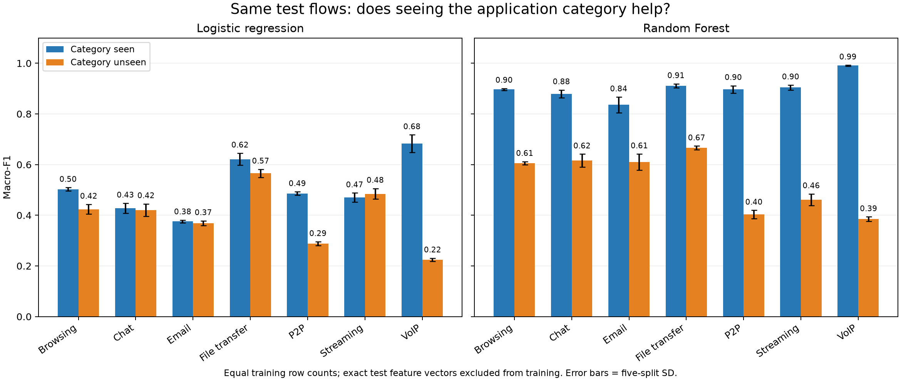
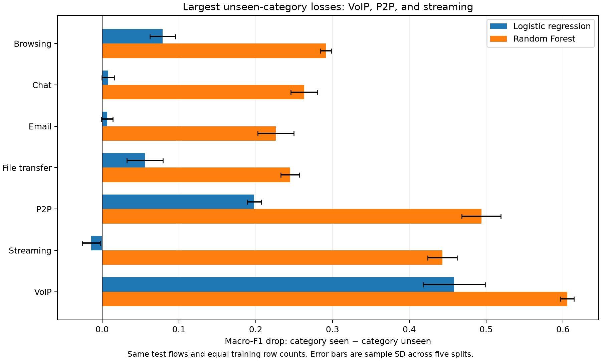
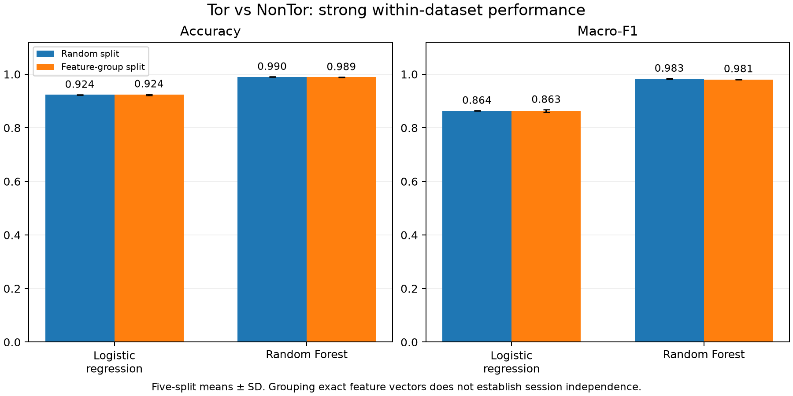

# Historical validation results — October 26, 2026

198 model evaluations. All numbers below come from `metrics.json`.

## Same test flows, equal training sizes

Each category has five paired tests. Both models see the exact same test rows per seed. The seen condition includes other flows from the test category in training; the unseen condition excludes the category entirely. Training row counts are equal and exact test feature vectors are purged from both training sets. Drop = seen macro-F1 minus unseen macro-F1. Standard deviations describe variation across five splits, not independent sessions.

| Model | Test category | Seen F1 | Unseen F1 | Drop, mean ± SD |
| --- | --- | --- | --- | --- |
| Logistic regression | Browsing | 0.503 | 0.424 | +0.079 ± 0.017 |
| Logistic regression | Chat | 0.428 | 0.420 | +0.008 ± 0.008 |
| Logistic regression | Email | 0.375 | 0.369 | +0.007 ± 0.007 |
| Logistic regression | File transfer | 0.621 | 0.565 | +0.056 ± 0.023 |
| Logistic regression | P2P | 0.486 | 0.288 | +0.198 ± 0.009 |
| Logistic regression | Streaming | 0.470 | 0.485 | -0.014 ± 0.012 |
| Logistic regression | VoIP | 0.682 | 0.224 | +0.458 ± 0.041 |
| Random Forest | Browsing | 0.897 | 0.606 | +0.291 ± 0.007 |
| Random Forest | Chat | 0.879 | 0.616 | +0.263 ± 0.017 |
| Random Forest | Email | 0.836 | 0.610 | +0.226 ± 0.024 |
| Random Forest | File transfer | 0.911 | 0.666 | +0.245 ± 0.012 |
| Random Forest | P2P | 0.897 | 0.403 | +0.494 ± 0.025 |
| Random Forest | Streaming | 0.904 | 0.461 | +0.443 ± 0.019 |
| Random Forest | VoIP | 0.991 | 0.385 | +0.606 ± 0.009 |

## VPN and Tor baselines

Exact-feature-group splits keep identical numeric feature vectors together. They are not session-disjoint splits. VPN random baselines remain in `../vpn_study/`. Tor NonTor is a separate label from VPN direct; scores are not comparable tasks.

| Dataset | Evaluation | Model | Accuracy, mean ± SD | Macro-F1, mean ± SD |
| --- | --- | --- | --- | --- |
| TOR | Random | Logistic regression | 92.36% ± 0.05 pp | 0.864 ± 0.001 |
| TOR | Random | Random Forest | 99.01% ± 0.09 pp | 0.983 ± 0.002 |
| TOR | Exact-feature-group split | Logistic regression | 92.35% ± 0.22 pp | 0.863 ± 0.005 |
| TOR | Exact-feature-group split | Random Forest | 98.90% ± 0.08 pp | 0.981 ± 0.001 |
| VPN | Exact-feature-group split | Logistic regression | 60.79% ± 1.18 pp | 0.595 ± 0.010 |
| VPN | Exact-feature-group split | Random Forest | 92.63% ± 0.36 pp | 0.926 ± 0.004 |

## Duration ablation (one seed, full-category LOAO)

This removes only the raw duration column. IAT/rate features can still encode duration-related information; it is not a complete timing ablation or a tuned feature selection result.

| Model | Category | Native F1 | Without duration F1 | Change |
| --- | --- | --- | --- | --- |
| Logistic regression | browsing | 0.430 | 0.442 | +0.012 |
| Logistic regression | chat | 0.414 | 0.561 | +0.147 |
| Logistic regression | email | 0.369 | 0.525 | +0.156 |
| Logistic regression | file transfer | 0.558 | 0.498 | -0.060 |
| Logistic regression | p2p | 0.291 | 0.558 | +0.267 |
| Logistic regression | streaming | 0.494 | 0.515 | +0.021 |
| Logistic regression | voip | 0.225 | 0.225 | +0.000 |
| Random Forest | browsing | 0.616 | 0.644 | +0.029 |
| Random Forest | chat | 0.632 | 0.635 | +0.004 |
| Random Forest | email | 0.590 | 0.583 | -0.007 |
| Random Forest | file transfer | 0.667 | 0.670 | +0.003 |
| Random Forest | p2p | 0.405 | 0.397 | -0.008 |
| Random Forest | streaming | 0.443 | 0.448 | +0.005 |
| Random Forest | voip | 0.387 | 0.385 | -0.002 |

## Interpretation limits

No real modern traffic or historical session IDs were available. Training-set composition changes between matched conditions even when row counts match. Correlated flows can remain. Exact duplicate-vector grouping does not establish capture independence. No confidence intervals or significance tests over independent sessions are claimed. Per-class metrics, majority-class baselines, confusion matrices and split fingerprints are in `metrics.json`.
